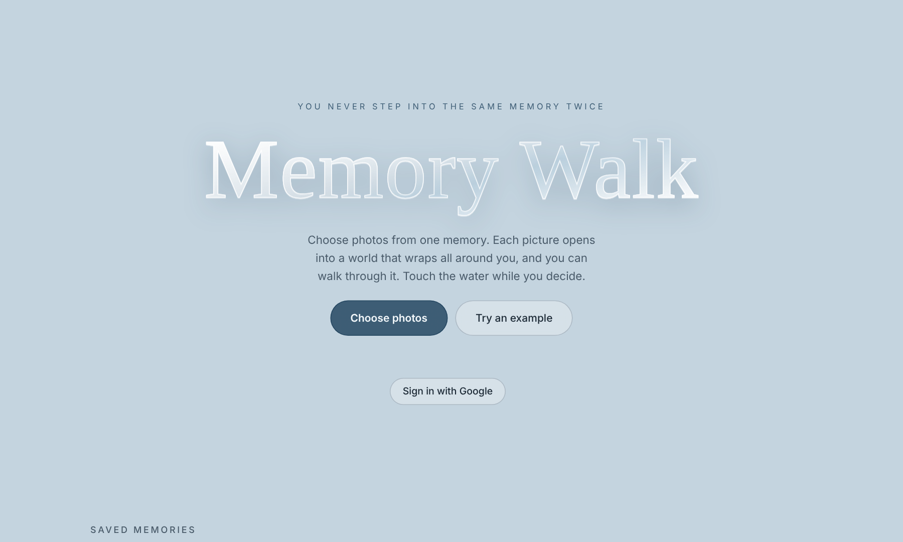

# Memory Walk

*You never step into the same memory twice.*

Choose photos from one memory. Each picture opens into a world that wraps all around you, and you can walk through it. The other photos from the same memory float nearby as doorways; walk into one to step into it.

**Live:** [memorywalk.netlify.app](https://memorywalk.netlify.app/)

## What it does

- Turns an ordinary photo into a walkable 360 environment. The photo and its mirror image are tiled side by side so the scene wraps around without a seam; everything below the horizon is laid flat on the ground at the distance it would really be from a standing viewer, everything above it is wrapped round and overhead, and a soft sky is sampled from the top of the picture.
- Guesses the horizon line automatically (the row where the image changes most between its upper and lower half) and lets you tune it with a slider until the ground lies flat.
- Up to 24 photos per memory, sorted by capture time. Drag, paste or pick photos; HEIC needs converting first.
- Desktop: drag to look, W A S D or arrows to walk, Shift to hurry. Touch: left half of the screen walks, right half looks. WebXR headsets get an Enter VR button with thumbstick locomotion.
- Saves memories either on the device (IndexedDB) or, after signing in with Google, in a private per-user space in Firestore. Photos are split into chunks small enough for one Firestore document each.
- The home page backdrop is a live GLSL shader of sunlight rippling on a pale sea; touching it sends rings across the surface.

## Stack

Single HTML file. Three.js r128 for the world, raw WebGL for the home page water, Firebase Auth and Firestore (compat SDK) for accounts and saved memories, IndexedDB as the offline fallback. No build step.

## Running it yourself

Open `index.html` over HTTP (any static server, or deploy to Netlify or GitHub Pages). To use your own Firebase project, replace `FIREBASE_CONFIG` in the script with your project's web config and enable Google sign-in and Firestore in the Firebase console. The config in the file is a Firebase web config, which is public by design; access is controlled by Firestore security rules, not by the key.

## Why

Part of an ongoing interest in neuroaesthetics and immersive experience design: what it does to a memory to be able to stand inside it, rather than look at it in a grid.
